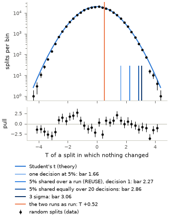
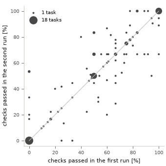
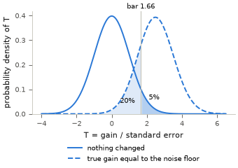

# Calibration: 2026-10-27-0528 and 2026-11-03-0803

Two runs of one harness (mode oracle, model claude-haiku-5-5, harness default) on the 125 validation tasks of split haiku-20-40-40 (csm 42, hr 41, itsm 42), 3 attempts each. Any difference between them is chance, so every acceptance below would be a false one. Each task's 6 attempts were split at random into two halves 200000 times and the test's statistic T computed for each split, on checks passed.

## Is the test calibrated?

| quantity                                                        | measured       | expected   |
|-----------------------------------------------------------------|----------------|------------|
| mean of T                                                       | -0.002 ± 0.002 | 0.000      |
| width of T                                                      | 1.009 ± 0.002  | 1.008      |
| splits accepted at one decision at 5% (%)                       | 4.97 ± 0.05    | 5          |
| splits accepted at 5% shared over a run (REUSE), decision 1 (%) | 1.20 ± 0.02    | 1.25       |
| splits accepted at 5% shared equally over 20 decisions (%)      | 0.21 ± 0.01    | 0.25       |
| splits accepted at 3 sigma (%)                                  | 0.11 ± 0.01    | 0.135      |
| splits accepted by any gain (%)                                 | 50.04 ± 0.11   |            |
| T of the two runs as they were run                              | 0.525          |            |

A calibrated test has a mean of 0, the width of Student's t, and accepts at each rule the share of no-change splits that the rule allows. A rule that keeps any gain accepts about half of them.

*Top: the T of every random split (points, with their counting errors) against Student's t (the line), on a logarithmic scale so that the tails show; the vertical marks are the bars of the decision rules and the long line is the T of the two runs as they were run. Bottom: the pull of each bin, its count minus the expected one in units of the expected count's error.*

## The noise the test has to see through

*Each task's score in the first run against its score in the second; a larger dot is more tasks. On the diagonal a task scored the same both times, and the spread around it is the noise between two runs of one harness.*

## What the test assumes

*What the test assumes: the statistic T when nothing changed (solid curve) and when the true gain equals the noise floor (dashed curve). The bar cuts off the shaded tail of the first, the share of false acceptances allowed, and leaves the shaded part of the second, the real gains missed.*

## Limits

- This measures false acceptance, not how often a real gain is found.
- A task's attempts are treated as interchangeable, so any difference between the days of the two runs counts as noise.
- It covers one decision at a time, not what a loop adds by reusing a run of the current harness across many candidates.
- The uncertainties are those of the random splitting alone. Every split draws on the same attempts, so another pair of runs would give slightly different numbers.

## Data

- `calibration.csv`: the table above, with each rule's bar
- `pulls.csv`: the T of every split
- `scores.csv`: each task's score in each run
