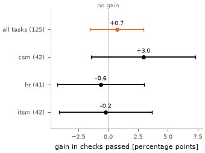
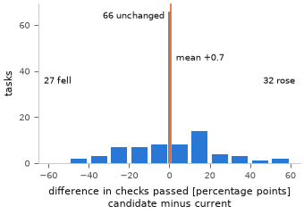
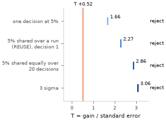
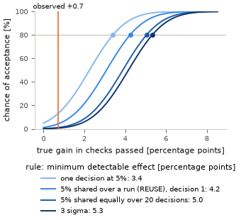

# Comparison: 2026-11-03-0803 against 2026-10-27-0528

## What is compared

| side      | run             | mode   | model            | harness   | attempts per task   |
|-----------|-----------------|--------|------------------|-----------|---------------------|
| current   | 2026-10-27-0528 | oracle | claude-haiku-5-5 | default   | 3                   |
| candidate | 2026-11-03-0803 | oracle | claude-haiku-5-5 | default   | 3                   |

The same 125 validation tasks of split haiku-20-40-40 on both sides (csm 42, hr 41, itsm 42).

## Result

| outcome               | current   | candidate   | gain                   | verdict at 5%    | minimum detectable effect   |
|-----------------------|-----------|-------------|------------------------|------------------|-----------------------------|
| checks passed         | 52.2%     | 52.9%       | +0.7 percentage points | reject (p 0.300) | 3.4 percentage points       |
| attempts fully passed | 20.5%     | 22.7%       | +2.1 percentage points | reject (p 0.139) | 4.9 percentage points       |

The decision uses "checks passed". Checks passed is each task's percentage of checks passed, averaged over its attempts and then over tasks, so every task counts equally. Attempts fully passed is the percentage of attempts in which every check passed.

## Cost and time

| side      | attempts   | cost per attempt   | total cost   | seconds per attempt   | errors   |
|-----------|------------|--------------------|--------------|-----------------------|----------|
| current   | 375        | $0.0087            | $3.26        | 16.5                  | 0        |
| candidate | 375        | $0.0093            | $3.48        | 17.6                  | 0        |

## By domain (checks passed)

| tasks    | current   | candidate   | gain (percentage points)   | minimum detectable effect (percentage points)   | verdict at 5%   |
|----------|-----------|-------------|----------------------------|-------------------------------------------------|-----------------|
| all, 125 | 52.2%     | 52.9%       | +0.7                       | 3.4                                             | reject          |
| csm, 42  | 52.7%     | 55.7%       | +3.0                       | 6.6                                             | reject          |
| hr, 41   | 55.6%     | 55.0%       | -0.6                       | 5.4                                             | reject          |
| itsm, 42 | 48.4%     | 48.2%       | -0.2                       | 5.8                                             | reject          |

The domain rows are for information. Only the first row decides.

*The gain on all tasks and in each domain. Each bar spans the gain plus and minus the bar on T times the standard error, so a row is accepted when its bar lies wholly to the right of the no-gain line. Only the row for all tasks decides.*

## The test in full (all 125 tasks)

| quantity                  | checks passed   | attempts fully passed   | what it is                                                  |
|---------------------------|-----------------|-------------------------|-------------------------------------------------------------|
| gain                      | +0.71           | +2.13                   | mean over tasks of candidate minus current                  |
| standard error            | 1.36            | 1.96                    | how far the gain would move if both runs were repeated      |
| T                         | +0.52           | +1.09                   | gain divided by standard error                              |
| bar on T                  | 1.66            | 1.66                    | T must exceed this to be accepted                           |
| p                         | 0.300           | 0.139                   | chance that a change that does nothing gives a T this large |
| lower bound               | -1.54           | -1.11                   | the true gain is above this with 95% confidence             |
| minimum detectable effect | 3.4             | 4.9                     | smallest true gain the test catches 4 times in 5            |
| tasks up / down / same    | 32 / 27 / 66    | 17 / 13 / 95            | tasks whose score rose, fell or stayed the same             |
| sign test p               | 0.301           | 0.292                   | cross-check using only the direction of each change         |
| permutation p             | 0.300           | 0.169                   | cross-check that does not assume the test's distribution    |
| bootstrap standard error  | 1.37            | 1.97                    | cross-check of the standard error by resampling tasks       |

Gain, standard error, lower bound, minimum detectable effect and bootstrap standard error are in percentage points.

*How many tasks rose, fell and stayed the same, in bins ten percentage points wide. The grey bar is the tasks that did not change; the line is the mean, which is the gain.*

## Decision rules (checks passed; T is +0.52)

| rule                                     | false acceptances allowed   | bar on T   | verdict   | minimum detectable effect (percentage points)   |
|------------------------------------------|-----------------------------|------------|-----------|-------------------------------------------------|
| one decision at 5%                       | 5%                          | 1.66       | reject    | 3.4                                             |
| 5% shared over a run (REUSE), decision 1 | 1.25%                       | 2.27       | reject    | 4.2                                             |
| 5% shared equally over 20 decisions      | 0.25%                       | 2.86       | reject    | 5.0                                             |
| 3 sigma                                  | 0.135%                      | 3.06       | reject    | 5.3                                             |

*The T observed (the vertical line) against the bar of each decision rule (the marks). A rule accepts when its bar lies to the left of the line.*

*The chance that a real gain of each size would be accepted under each decision rule: theory, from this comparison's standard error. Each curve crosses 80% at that rule's minimum detectable effect, marked; the vertical line is the gain observed.*

## Data

- `tests.csv`: every number above, for every outcome and set of tasks
- `rules.csv`: the decision rules
- `sides.csv`: the two sides, with their cost and time
- `differences.csv`: one row per task
