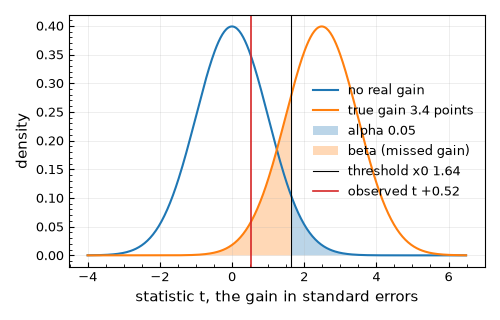
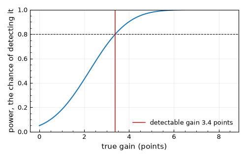
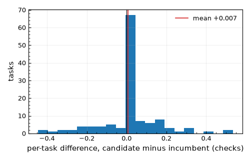
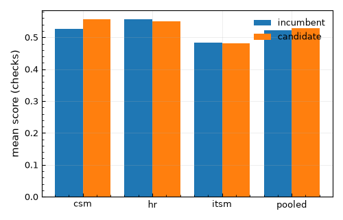

# The acceptance gate

The optimiser proposes a changed harness, the candidate, and must decide
whether it is better than the harness it has, the incumbent. The decision is
made on the validation tasks and is a statistical test: the candidate's gain
has to be larger than the gain that chance alone produces between two runs of
one and the same harness. This page defines the quantities, states the test
and the rules that set its level, and shows them on the two baseline runs of
the same harness, where any acceptance is a false one. The code is
`mas_optimiser.stats`; the command `mas-optimiser compare` produces every
table and figure below.

## Scores and differences

A *task* is one request to the agent, judged by several *checks*, each a row
the database must hold afterwards. An *attempt* is one run of the agent on
one task; each task is attempted $K$ times per harness ($K = 3$ in the
baselines). Two outcomes score an attempt:

- *task success*: 1 if every check passed, else 0;
- *fraction of checks passed*: checks passed over checks total.

A task's score under a harness is the mean of its attempts' outcomes. With
task success and three attempts it is one of $0, 1/3, 2/3, 1$; with the
fraction it takes many values. For a candidate $B$ and an incumbent $A$ run
on the same $N$ tasks, the per-task difference is

$$d_i = \text{score}_i(B) - \text{score}_i(A), \qquad i = 1, \dots, N,$$

and the estimated gain is $\bar d$, the mean of the $d_i$. Pairing on the
task removes the task's own difficulty from the comparison, so the sides must
have scored the same tasks (`stats.outcomes.paired`).

The gate uses the fraction of checks passed, declared as the primary outcome
before any comparison was run, and reports task success beside it. The
fraction has the lower noise floor (below), at the price of meaning: partial
credit can rise without more tasks being finished, which is why the coarser
outcome is always shown.

## The test

The null hypothesis $H_0$ is that the candidate's true mean gain is at most
zero; the alternative $H_1$ is that it is positive. The test statistic is the
observed mean in units of its standard error,

$$\text{SE} = \frac{s_d}{\sqrt{N}}, \qquad T = \frac{\bar d}{\text{SE}},$$

with $s_d$ the sample standard deviation of the differences (Bessel's
correction). The mean of many bounded differences is close to normal by the
central limit theorem, so under $H_0$ the statistic is a standard normal
variable, and the gate keeps the candidate when

$$T > X_0 = \Phi^{-1}(1 - \alpha),$$

where $\alpha = P(T > X_0 \mid H_0)$ is the Type-I error allowed for the
decision, the chance of accepting a candidate that is no better. The
p-value is $P(T \ge t_{\text{obs}} \mid H_0) = 1 - \Phi(t_{\text{obs}})$, and
$\bar d - X_0\,\text{SE}$ is a one-sided lower confidence bound on the true
gain at confidence $1 - \alpha$. The normal quantile is used rather than
Student's $t$; at $N = 125$ the two thresholds differ by 0.01. The test is
`stats.gate.mean_test`; the theory is textbook (Barlow, *Statistics*, Wiley,
1989, the chapters on errors and on hypothesis testing).

The second error is missing a real gain: $\beta = P(T < X_0 \mid H_1)$, and
$1 - \beta$ is the *power*. With a true gain $g$ the statistic is centred on
$g / \text{SE}$, so the power at $g$ is $1 - \Phi(X_0 - g/\text{SE})$
(`stats.gate.power`), and the smallest gain found with power $0.8$, the
*minimum detectable gain* or noise floor, is

$$g_{\min} = (z_{1-\alpha} + z_{0.8})\,\text{SE} = 2.49\,\text{SE} \quad
\text{at } \alpha = 0.05$$

(`stats.gate.detectable`). The floor is a property of the data's noise, not
of any rule: a rule either respects it or accepts noise.

Three checks are reported beside the test, none in its place
(`stats.gate`):

- the *exact sign test* on the tasks whose score changed: under $H_0$ each
  changed task is a fair coin, so $p = P(\text{Bin}(M, 1/2) \ge n_+)$ with
  $M$ the changed tasks and $n_+$ the candidate's wins (Sun et al., 2026,
  Lemma A2); it uses only the direction of each difference;
- the *permutation test*: under $H_0$ the two harnesses' scores on a task are
  exchangeable, so each difference keeps its size and takes a random sign;
  the p-value is the fraction of such relabellings whose mean is at or above
  the observed one (Efron and Tibshirani, *An Introduction to the Bootstrap*,
  Chapman and Hall, 1993, the chapter on permutation tests); it assumes
  nothing about the differences' distribution;
- the *bootstrap*: the tasks resampled with replacement, giving the spread of
  the mean difference as a check on the analytic standard error and a
  quantile lower bound (Efron and Tibshirani, 1993, the chapters on the
  bootstrap standard error and on percentile intervals).

## The level of each decision

One decision at $\alpha = 0.05$ is one thing; a run that decides twenty times
on the same tasks is another. If each decision had a 5% chance of a false
acceptance, the chance of at least one in twenty would be up to
$20 \times 5\%$ and is $1 - 0.95^{20} = 64\%$ when the decisions are
independent, by the rule that the probability of "A or B" is at most the sum
of the two probabilities. Later candidates also depend on which earlier ones
were accepted, so the tests are not fixed in advance. `stats.budget` offers
three ways to set each decision's level, shown side by side by `compare`:

- **REUSE allocation** (Sun et al., *Which Self-Improvements Should We
  Trust?*, arXiv:2609.33180, 2026, Eq. 4), the gate's rule: decision $t$,
  after $p$ promotions, with $K$ candidates in the round, is made at

  $$\delta_{t,p} = \frac{\alpha\, w_t\, v_p}{\binom{t-1}{p} K^{p+1}},
  \qquad w_t = \frac{1}{t(t+1)}, \quad v_p = \frac{1}{(p+1)(p+2)}.$$

  The weights sum to one over rounds and over promotion counts, and the
  binomial coefficient and the power of $K$ cover every history of
  promotions, so the levels of all decisions a run could make sum to at most
  $\alpha$: with probability at least $1 - \alpha$ every promotion in the run
  is a true improvement, however the proposer adapts. Later rounds and more
  promotions get smaller levels, so stronger evidence is demanded as the run
  goes on.
- **Equal split** (Bonferroni's inequality): $\alpha$ divided by a number of
  decisions fixed before the run. Valid, simple, and blind to how the run
  unfolds.
- **Fixed significance**: the same threshold in standard deviations at every
  decision, three for evidence and five for discovery by the conventions of
  particle physics ($\alpha = 0.00135$ and $2.9 \times 10^{-7}$ one-sided).
  It controls each decision, not the run.

The test statistic under the REUSE allocation is the normal-form $T$ above.
The paper proves its guarantee for its own exact sign test on pass/fail
scores and, for bounded scores, for a distribution-free lower confidence
bound (its appendix A.1, `stats.gate.bernstein_bound`). That bound is
reported for comparison and not used, because on 125 tasks it needs a gain
about three times larger than $T$ does before it clears zero (table below);
with $T$ the guarantee holds in the large-sample sense that the central limit
theorem provides.

## The baseline runs: what chance alone produces

The two baseline runs of 27 October and 3 November are the same harness,
model and tasks, so the true gain between them is zero and every acceptance
below would be false. On the 125 validation tasks of the split
`haiku-20-40-40`, three attempts each (`figures/gate/comparison.md` holds
the full report):

| Outcome | $\bar d$ (points) | SE (points) | $T$ | $p$ | Detectable gain (points) | Sign test | Permutation $p$ | Bootstrap SE | Bernstein bound |
|---|---|---|---|---|---|---|---|---|---|
| Fraction of checks passed | +0.71 | 1.36 | +0.52 | 0.30 | 3.4 | 32 up, 27 down, $p$ 0.30 | 0.30 | 1.37 | −8.4 |
| Task success | +2.13 | 1.96 | +1.09 | 0.14 | 4.9 | 17 up, 13 down, $p$ 0.29 | 0.14 | 1.97 | −8.4 |

No test accepts the null change. The three p-values of each row agree, which
is the normal approximation checked by two methods that do not assume it,
and the bootstrap reproduces the analytic standard error. The fraction's
floor is 3.4 points against 4.9 for task success because its per-task
differences take 32 distinct values rather than 5 and so spread less. Per
domain the floors are 5 to 9 points, which is why the gate pools the three
domains and logs per-domain scores without deciding on them. At the plan's
two attempts per task the pooled standard error grows by $\sqrt{3/2}$ and the
floor to about 4.2 points on the fraction.

The decision rules on the pooled fraction, same data:

| Rule | Level | $X_0$ | Verdict | Detectable gain (points) |
|---|---|---|---|---|
| level as given, 0.05 | 0.05 | 1.64 | reject | 3.4 |
| fixed 3 sigma | 0.0013 | 3.00 | reject | 5.2 |
| equal split over 20 decisions | 0.0025 | 2.81 | reject | 5.0 |
| REUSE allocation, round 1, no promotions, 1 candidate | 0.013 | 2.24 | reject | 4.2 |

Earlier work on acceptance rules for harness edits showed what happens
without a noise term: on the same two runs, a rule that keeps any candidate
whose mean is higher accepted the null change in three comparisons out of
eight, and a rule with a band calibrated from the runs it judged in four
(the project's gate evidence). Every rule with a noise term accepted none.

## Decisions recorded here

- The gate's outcome is the fraction of checks passed; task success is
  reported beside it.
- The gate's statistic is the one-sided normal-form $T$, pooled over domains;
  the sign test, the permutation test and the bootstrap are reported beside
  it, and the Bernstein bound for comparison.
- Each decision's level comes from the REUSE allocation with a run budget of
  $\alpha = 0.05$; the equal split and the fixed significance are shown
  beside it.
- Per-domain scores are logged at every decision and never gated on.
